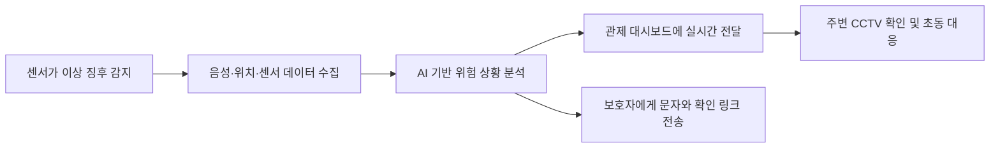

# 🦯 민증의 지팡이

> **범죄 취약 계층의 초동 대응을 위한 스마트 장치 및 AI 기반 실시간 대응 서비스**  
> 음성·위치·센서 정보를 분석해 위험을 감지하고 보호자의 빠른 대응을 돕습니다.

---

## 📝 1. 프로젝트 개요

**민증의 지팡이**는 어린이와 청소년 등 범죄에 취약한 사용자의 위험 상황을 자동으로 감지하는 스마트 방범 시스템입니다.

지팡이형 장치가 음성, GPS 위치, 충격, 진동과 주변 소리를 수집하면 AI가 위험 가능성을 분석합니다. 감지된 상황은 보호자와 관제 대시보드에 실시간으로 전달되며, 사용자의 위치를 기준으로 주변 CCTV 정보도 함께 제공합니다.

- **대상 사용자**: 범죄와 사고에 취약한 어린이·청소년 및 보호자
- **핵심 가치**: 사용자가 직접 신고하기 어려운 순간에도 위험 징후를 감지하고 현장 정보를 전달하는 것

---

## 🚨 2. 기획 배경 및 해결 방안

### 2.1. 기존 방식의 한계

1. **CCTV의 제한된 범위**  
   CCTV가 설치되지 않았거나 촬영 범위를 벗어난 장소에서는 상황을 확인하기 어렵습니다.

2. **수동 신고의 어려움**  
   기존 웨어러블 장치는 사용자가 직접 버튼을 눌러야 하는 경우가 많아 갑작스러운 범죄나 사고에 대응하기 어렵습니다.

3. **부족한 현장 정보**  
   단순 위치 알림만으로는 보호자가 실제 위험 수준과 현장 상황을 판단하기 어렵습니다.

### 2.2. 민증의 지팡이의 해결 방식

- **복합 센서 감지**: 충격, 진동, 소리와 움직임을 함께 활용해 이상 징후를 확인합니다.
- **AI 상황 분석**: 음성과 센서 데이터를 분석해 위험 상황의 가능성을 판단합니다.
- **실시간 정보 전달**: 위치, 음성 및 상황 진행 정보를 보호자와 관제 화면에 전달합니다.
- **CCTV 연계**: 현재 위치 주변의 CCTV를 찾아 현장 파악과 초동 대응을 지원합니다.

---

## ⭐ 3. 핵심 기능

1. **위험 상황 자동 감지**  
   충격, 진동, 주변 소리와 움직임을 함께 분석해 이상 징후를 감지합니다.

2. **현장 음성 기록**  
   위험 상황이 발생하면 주변 음성을 녹음해 당시 상황을 확인할 수 있도록 합니다.

3. **실시간 위치 추적**  
   GPS를 통해 사용자의 현재 위치와 이동 경로를 전달합니다.

4. **AI 기반 상황 분석**  
   수집한 음성과 센서 데이터를 바탕으로 범죄 또는 위험 상황의 가능성을 판단합니다.

5. **보호자 알림**  
   위험이 감지되면 보호자에게 문자와 상황 확인 링크를 전송합니다.

6. **실시간 관제 대시보드**  
   사용자의 위치, 현장 음성, 센서 정보와 상황 진행 상태를 한 화면에서 확인할 수 있습니다.

7. **주변 CCTV 연계**  
   사용자의 위치를 기준으로 가까운 CCTV를 조회해 현장 파악과 초동 대응을 지원합니다.

---

## 🔄 4. 서비스 동작 과정

1. 스마트 장치가 충격, 진동, 소리 등 이상 징후를 감지합니다.
2. 현장 음성과 GPS 위치, 센서 데이터를 수집합니다.
3. AI가 수집된 정보를 분석해 위험 상황 여부를 판단합니다.
4. 분석 결과와 현장 정보를 관제 대시보드에 실시간으로 표시합니다.
5. 보호자에게 알림을 전송하고 주변 CCTV 정보를 제공해 신속한 대응을 돕습니다.

---

## 🏗️ 5. 시스템 구성

| 구성 | 역할 |
| --- | --- |
| 스마트 지팡이 | 음성, 위치, 충격, 진동 및 소리 데이터 수집 |
| AI 분석 시스템 | 수집된 데이터를 기반으로 위험 상황 판단 |
| 통합 서버 | 장치 데이터 처리, 상황 기록 및 알림 전달 |
| 관제 대시보드 | 위치, 음성, 센서 정보와 상황 이력 확인 |
| 보호자 알림 서비스 | 위험 상황과 확인 링크를 문자로 전달 |

---

## 🎯 6. 기대 효과

- 사용자가 직접 신고하기 어려운 상황에서도 위험 징후를 감지할 수 있습니다.
- 보호자와 관계기관에 현장 정보를 빠르게 전달해 초동 대응 시간을 줄일 수 있습니다.
- 음성, 위치와 여러 센서 정보를 함께 활용해 단일 센서보다 구체적인 상황 판단을 지원합니다.
- 실시간 정보와 과거 기록을 통해 위험 상황의 확인과 사후 대응을 돕습니다.

---

## 👥 7. 팀원

안양대학교 소프트웨어학과 학생 6명이 스마트 장치, AI 분석, 서버와 관제 서비스를 함께 개발했습니다.

- 김민증
- 김동준
- 오태양
- 유진영
- 이규현
- 차순욱

---

## 🏆 8. 과제 안내

본 프로젝트는 한국지능정보사회진흥원의 출연금으로 수행한 **K-디지털 챌린지: NET 챌린지 캠프 시즌 12 연구망 활용 연구과제**의 결과입니다.
